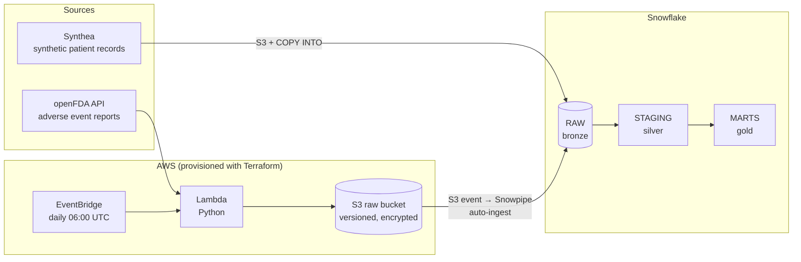
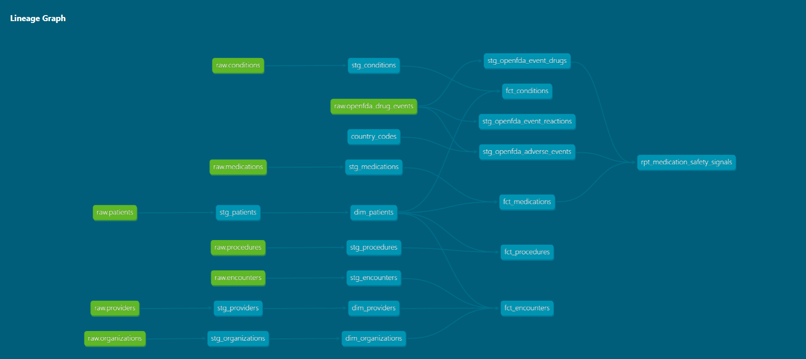

# Healthcare Data Platform: Medication Safety Signals

**Which medicines our patients are taking are also showing up in recent drug-safety reports?**

Hospitals, GP networks and health systems hold detailed records of what their patients are prescribed. Regulators publish reports of suspected adverse drug reactions. The two almost never meet: prescribing data sits in patient record systems, safety reports sit in a regulator's database, and checking one against the other is usually a manual, occasional exercise.

This project builds the data platform that joins them automatically. It combines patient-level prescribing data with live adverse event reports from the US FDA, and produces a daily view of **every medication in the patient population, how many patients take it, and how many recent reports name it as the suspected cause of a reaction.**

**Stack:** Snowflake · dbt Core · AWS (S3, Lambda, EventBridge, IAM, CloudWatch) · Snowpipe · Terraform · Python · SQL

---

## The real-world problem

Medicines safety work (pharmacovigilance) depends on spotting problems early. When a drug starts appearing in serious adverse event reports, the people responsible for patient safety need to know quickly:

- **Is this drug used in our population, and by how many patients?**
- **Were the reports serious** (hospitalisation, disability, death)?
- **Was the drug the suspected cause,** or just something the patient happened to be taking?

Answering that today usually means exporting prescribing data, searching a regulator's database by hand, and matching drug names in a spreadsheet. Drug names don't match cleanly across systems ("Aspirin 81 MG Oral Tablet" vs "ASPIRIN"), reports arrive continuously, and the check is rarely repeated.

**Who would use this:** medicines optimisation and pharmacy teams, medication safety officers, clinical governance teams, and population health analysts.

## What this platform does

| Problem | How the platform solves it |
|---|---|
| Prescribing data and safety reports live in separate systems | Both land in one Snowflake warehouse and are modelled in the same dbt project |
| Drug names don't match across systems | Matching uses **RxNorm codes**, the standard drug coding system used by both sources, not free-text names |
| A patient's other medicines get blamed by association | Only drugs flagged as the **suspected cause** in a report are counted |
| Safety data arrives continuously | A Lambda pulls new reports daily, and **Snowpipe** loads each file into Snowflake automatically within about a minute |
| Health data needs governance | Encrypted storage, no public access, least-privilege IAM, keyless Snowflake access, and secrets kept out of version control |
| Results must be trustworthy | dbt tests on every build, row-count reconciliation between layers, and zero orphan records |

The same design applies to UK data: the FDA feed could be swapped for the MHRA Yellow Card scheme, and the synthetic records for an extract from a GP or hospital record system.

---

## Architecture



## Lineage



The two sources are cleaned separately in silver and combined only in gold, in `rpt_medication_safety_signals`.

---

## Data sources

| Source | What it contains | Why it was chosen |
|---|---|---|
| **Synthea** | Synthetic but realistic patient records: patients, encounters, conditions, medications, procedures, providers, organisations | Mirrors the structure of real electronic health records with no privacy risk |
| **openFDA drug adverse event API** | Public FDA Adverse Event Reporting System (FAERS) reports: the drugs involved, each drug's role, the reactions, seriousness and outcomes | Free, live, regulator-grade safety data in nested JSON |

## Data layers

| Layer | Snowflake schema | Materialisation | Contents |
|---|---|---|---|
| Bronze | `healthcare.raw` | Tables | 7 Synthea tables; openFDA reports stored whole as JSON in a `VARIANT` column |
| Silver | `healthcare.staging` | Views | 7 Synthea models, 3 openFDA models, a country lookup seed |
| Gold | `healthcare.marts` | Transient tables | 3 dimensions, 4 facts, 1 safety signals report |

Silver models are views, so they always reflect the latest raw data without storing a second copy. Gold models are tables because they are joined and queried repeatedly. Transient tables skip Snowflake's Fail-safe storage, lowering cost for data dbt can rebuild at any time.

## The models

**Patient data (constellation schema)**
- Dimensions: `dim_patients`, `dim_providers`, `dim_organizations`
- Facts: `fct_encounters`, `fct_conditions`, `fct_medications`, `fct_procedures`

`dim_patients` is shared by all four facts. Facts join to it with inner joins, so a record pointing at a patient who doesn't exist can never reach the gold layer.

**Safety reports (openFDA silver)**

| Model | One row per | What it handles |
|---|---|---|
| `stg_openfda_adverse_events` | Report | Removes duplicate reports from overlapping daily pulls; gives every report a country name |
| `stg_openfda_event_drugs` | Drug in a report | Unpacks the nested drug list; keeps each drug's role (suspect, concomitant, interacting) and RxNorm codes |
| `stg_openfda_event_reactions` | Reaction in a report | Unpacks the nested reaction list; keeps the medical term and outcome |

**The answer (gold)**
- `rpt_medication_safety_signals`: one row per medication prescribed in the patient population, with the number of patients taking it and the number of FDA reports, and serious reports, in which it was the **suspected** drug.

---

## Results

- From an initial sample of 100 FDA reports, **16 of the 262 medications** prescribed in the patient population (about 6%) appeared as the suspected drug in at least one report.
- Counting every drug mentioned, rather than only suspected drugs, gave 30 matches. Filtering to suspected drugs removed medications that were only in the report because the patient was also taking them.
- Patient data reconciles exactly between silver and gold for all four fact tables (about 381k rows) with **zero orphan records**.
- Overlapping daily pulls (300 loaded rows) deduplicate to 100 unique reports, verified by a `unique` test.

## Limitations

- **A signal is not proof.** FAERS reports are voluntary, and serious events are far more likely to be reported. Report counts are not rates and do not show that a drug caused a reaction. The output flags medicines for review; it does not replace clinical judgement.
- **Small sample.** Each daily run pulls 100 reports; matches grow as data accumulates.
- **Formulation-level matching.** RxNorm codes are specific to strength and form, so one ingredient (for example albuterol) can appear as several rows.
- **Publishing lag.** FDA data typically trails real time by a few months.
- **Synthetic patients.** Patient records are generated, not real.

---

## Engineering highlights

- **Infrastructure as code.** S3, IAM roles, Lambda, CloudWatch logs, the EventBridge schedule, the Snowflake access role and the Snowpipe notification are all defined in Terraform.
- **Event-driven ingestion.** S3 notifies Snowpipe when a file lands, so loading needs no schedule or manual step. Files that existed before the trigger were backfilled with a targeted `COPY INTO` to avoid duplicate loads.
- **Keyless, least-privilege access.** The Lambda can only write to `openfda/`. Snowflake reads S3 by assuming a read-only IAM role through a storage integration with an external ID, so no AWS keys are stored anywhere. dbt connects to Snowflake with an RSA key pair.
- **Nested JSON to relational tables** with `LATERAL FLATTEN`, and deduplication with `QUALIFY ROW_NUMBER()`.
- **Schema inference** for the bronze CSV tables with `INFER_SCHEMA` and `USING TEMPLATE`, with types enforced in silver.
- **Data quality** through dbt tests (`unique`, `not_null`, `relationships`) on every build and reconciliation between layers.

## Repository structure

```
healthcare-data-platform/
├── dbt_healthcare/
│   ├── dbt_project.yml
│   ├── macros/generate_schema_name.sql
│   ├── seeds/country_codes.csv
│   └── models/
│       ├── staging/              # silver: 10 models, sources, tests
│       └── marts/                # gold: dimensions, facts, report, tests
├── ingestion/
│   └── lambda_function.py        # openFDA API → S3
├── terraform/                    # S3, IAM, Lambda, EventBridge, Snowflake role, Snowpipe notification
├── snowflake/
│   ├── snowflake_synthea_setup.sql
│   └── snowflake_openfda_setup.sql
├── docs/lineage.png
└── requirements.txt
```

## Project status

The Snowflake trial account used for this project has ended, so the daily schedule is paused. The code, setup scripts, lineage graph and results above document the working system, and it can be rebuilt on a new Snowflake account using the steps below.

## Setup

**Prerequisites:** Python 3.12, Terraform 1.5+, AWS CLI configured, a Snowflake account, Java (to run Synthea).

1. **Generate patient data** with [Synthea](https://github.com/synthetichealth/synthea) (CSV export), upload the CSVs to S3, and run `snowflake/snowflake_synthea_setup.sql`.
2. **Deploy the AWS infrastructure:**
   ```bash
   cd terraform
   terraform init
   terraform apply
   ```
3. **Connect Snowflake to S3:** run sections 1 to 6 of `snowflake/snowflake_openfda_setup.sql`. Put the integration's `STORAGE_AWS_IAM_USER_ARN` and `STORAGE_AWS_EXTERNAL_ID`, and the pipe's `notification_channel`, into `terraform/terraform.tfvars` (gitignored), then run `terraform apply` again.
4. **Build the models:**
   ```bash
   python -m venv .venv
   .venv/Scripts/activate        # Windows; use source .venv/bin/activate on macOS/Linux
   pip install -r requirements.txt
   cd dbt_healthcare
   # create profiles.yml with your Snowflake connection (not committed)
   dbt seed
   dbt build
   dbt docs generate && dbt docs serve
   ```

## Next steps

- Schedule `dbt build` daily with GitHub Actions so the gold layer refreshes without manual steps
- Roll safety signals up to ingredient level, so all strengths of a drug appear as one row
- Incremental dbt models for openFDA, so only new reports are processed
- dbt source freshness checks to alert if the daily feed stops
- A dedicated least-privilege Snowflake role for automation instead of an admin role
- A dashboard for pharmacy and safety teams
